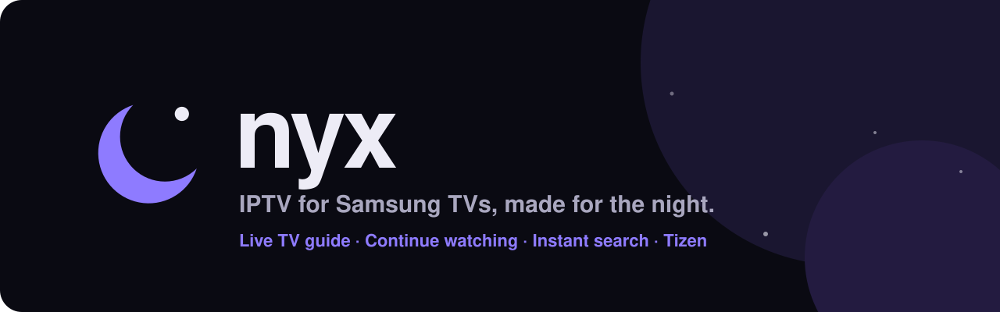
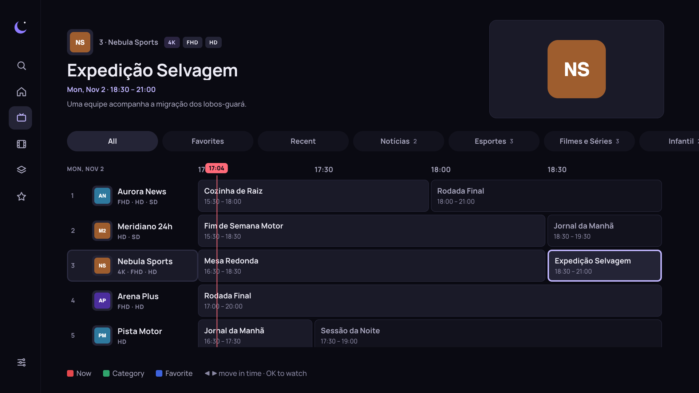
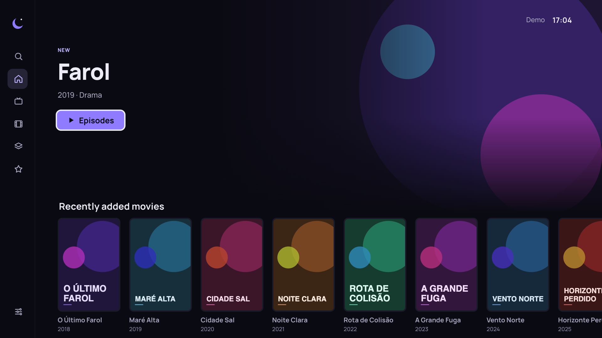
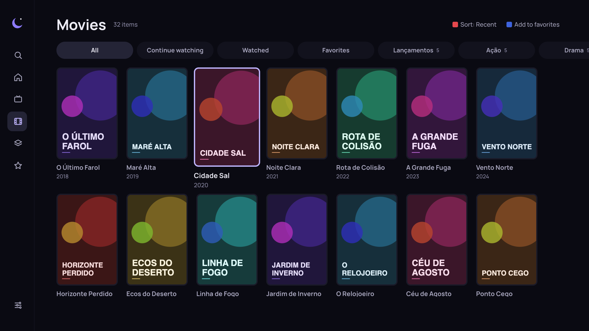
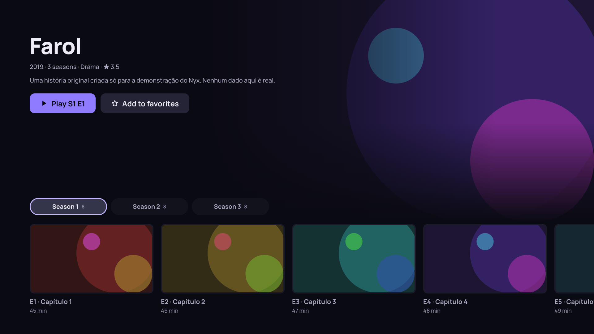
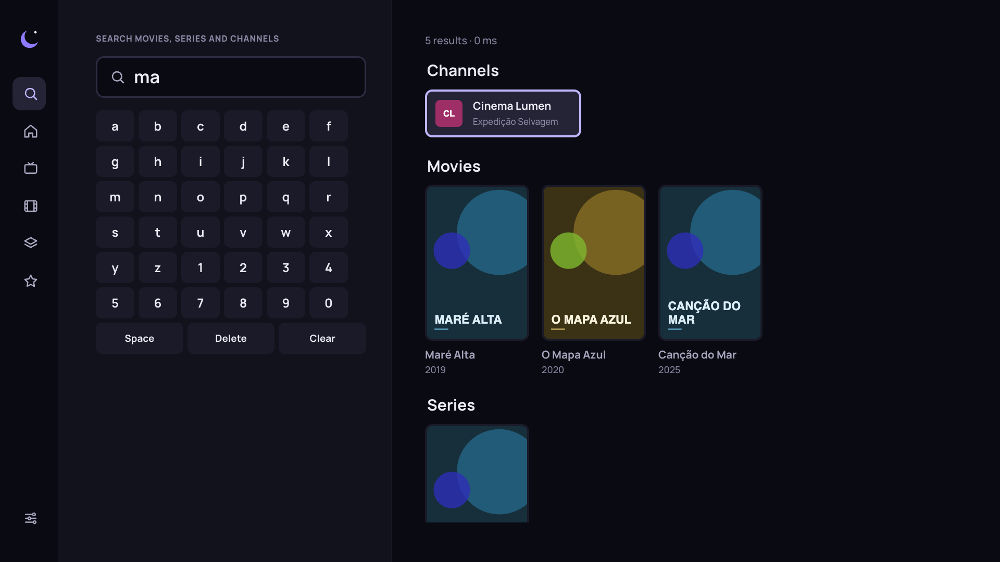
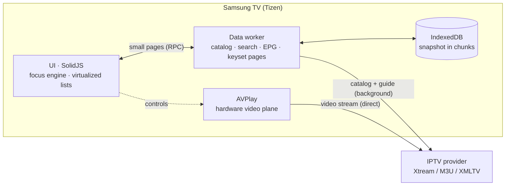

<p align="center">
  
</p>

<p align="center">
  
  
  
  
  
  
</p>

<p align="center">
  <b>English</b> · <a href="#-português">Português</a>
</p>

<p align="center">
  
</p>

## 🌙 What is Nyx?

**Nyx** is an IPTV player for Samsung Smart TVs (Tizen), designed for the couch at night:
a dark interface that never flashes white, focus you can see from three meters away,
and an app that stays fast on an entry-level TV.

You bring your own playlist (**Xtream Codes** or **M3U**). Nyx turns it into a real TV guide,
groups SD/HD/FHD/4K duplicates into one channel, remembers exactly where you stopped and
searches 40 thousand titles while you type.

> Nyx is a player. It does not provide, host or sell any content.

## ✨ Features

| | |
|---|---|
| 📺 **Real TV guide** | 8-day EPG grid with a "now" line, time navigation with ◀ ▶, category filters and reminders (🔔 1 min before it starts). |
| 🎚️ **Smart quality** | SD/HD/FHD/4K variants become one channel. If a stream stalls, Nyx drops a level on its own (4K → FHD → HD → SD) and remembers it. |
| 🌙 **Sleep timer & tracks** | Turn off in 15–90 min, dubbed/subtitled track selection (Portuguese audio picked automatically when available). |
| ▶️ **Continue watching** | Movies and episodes resume at the exact second. "Next episode" button near the end, plus autoplay. |
| 🔍 **Instant search** | In-memory search across channels, movies and series: 10–35 ms on the TV, accent-insensitive. |
| ⭐ **Favorites & history** | Favorite channels, movies and series. "Continue watching" and "Watched" tabs; posters show where you stopped (S2 E5) and series you follow get a "New ep." badge. |
| ⚡ **Fast on weak hardware** | Data lives in a Web Worker, lists are virtualized, and the app opens from cache in under a second. |
| 🎬 **TMDB (optional)** | With a free key: synopsis, age rating, backdrop, cast with photos, real episode titles/images, trailer and "Similar titles you have" — never blocks: if TMDB fails, the screen is the same as without it. |
| 🌐 **3 languages** | Português (Brasil), English, Español. |
| 🔒 **Parental PIN** | Adult categories hidden by default (PIN `0000`, changeable). |
| 🎨 **Own design system** | Night palette, Manrope, focus ring + scale, zero blur and zero heavy shadows. |

## 📸 Screenshots

<table>
  <tr>
    <td></td>
    <td></td>
  </tr>
  <tr>
    <td></td>
    <td></td>
  </tr>
</table>

<sub>Screenshots use the fictional demo server (<code>bun run demo</code>). Every title, channel and poster in them is made up.</sub>

## 📲 Install on your TV

Nyx is not in the Samsung store. You install it **once** with [Apps2Samsung](https://github.com/Apps2Samsung/Apps2Samsung),
a free community app for Android or computer that sends Nyx to the TV over Wi‑Fi. No Tizen Studio.

1. Install **Apps2Samsung** on your phone or computer.
2. On the TV: *Apps* → type `12345` → *Developer mode* on → *Host PC IP* = the phone’s/computer’s IP → restart the TV.
3. In Apps2Samsung: pick your TV → **Nyx** (*IPTV & Live TV*) → **Install**.

👉 **[Step-by-step guide, updates and troubleshooting](docs/INSTALL.md)**

## ⚡ Measured on a real TV

Every architecture decision came from benchmarks on a **Samsung UN50AU7700** (2021, Tizen 6.0, ARMv7, 2 GB, Chromium 76).
The diagnostic app that produced them is in [`tools/diag`](tools/diag).

| What | Result |
|---|---|
| Open the app (from cache) | **< 1 s** |
| Search 31,854 movies (in memory, in a worker) | **10–35 ms** |
| Parse an 8-day guide (43,778 programs) | **0.2 s** |
| Save the catalog in IndexedDB (chunks) | **0.44 s** (vs 22 s writing one record per item) |
| WebSQL insert of the same catalog | 4.9 s, **UI frozen 1.7 s**. Rejected |
| App bundle | **145 KB** (42 KB gzip) + 26 KB worker |

## 🧭 How it works



- **The UI never holds the full catalog.** The worker owns the data and answers with pages of ~30–70 items (keyset cursors).
- **No backend.** Everything runs on the TV. Video goes straight from the provider to the hardware decoder.
- **Navigation without layout reads.** The remote-control focus engine moves by index through a tree of zones and lists, so it never forces a reflow.

## 🚀 Getting started

### Requirements

- Samsung TV with Tizen 6.0+ in **Developer Mode**: on the TV, open *Apps*, type `12345` on the remote, turn Developer Mode on, set *Host PC IP* to your computer's IP and restart the TV.
- [Bun](https://bun.sh) ≥ 1.3 and [Tizen Studio CLI](https://developer.tizen.org/development/tizen-studio/download) (macOS/Linux).

### 1. Try it in the browser (no TV, no playlist)

```bash
bun install
bun run demo          # fictional Xtream server on http://localhost:8790
bun run dev           # app on http://localhost:5173
```

Add a playlist in the app: server `http://localhost:8790`, user `demo`, password `demo`.
On the keyboard, arrows navigate, Enter is OK, Esc is Back, and F1–F4 are the red/green/yellow/blue keys.

### 2. Build and install on your TV

```bash
# one time: signing certificate + profile
~/tizen-studio/tools/ide/bin/tizen certificate -a nyx -p <password> -c BR -n "Your Name" -f nyx
~/tizen-studio/tools/ide/bin/tizen security-profiles add -n nyx -a ~/tizen-studio-data/keystore/author/nyx.p12 -p <password>

# build, sign, install and open
TV_IP=192.168.0.50 ./scripts/tv.sh
```

Optional `.env.local` (never committed). With it, `./scripts/tv.sh --seed` opens the app already logged in, so you don't have to type with the remote:

```bash
XC_NAME=My playlist
XC_HOST=http://your-server:8080
XC_USER=your_user
XC_PASS=your_password
TMDB_KEY=your_tmdb_v3_key   # optional
```

`./scripts/tv.sh --report` streams the TV's errors to your computer (`bun run report`).

## 🎮 Remote control

| Key | Guide | Player (live) | Player (movie/episode) |
|---|---|---|---|
| ◀ ▶ | move in time | ◀ channel list | −10 s / +10 s (hold to speed up) |
| ▲ ▼ | change channel | change channel (with debounce) | show info |
| OK | watch | channel list (mini guide) | pause / play |
| Back | now → categories → menu | show info → exit | show info → exit |
| 🔴 Red | jump to now | — | — |
| 🟢 Green | categories | — | — |
| 🟡 Yellow | remind me | options: quality, audio, subtitles, sleep timer | options: audio, subtitles, sleep timer |
| 🔵 Blue | favorite | favorite | — |
| CH ▲▼ | — | change channel | — |
| ⏪ ⏩ | — | — | −30 s / +30 s |

## 🗂️ Project structure

```
src/
  app/        shell, router, focus engine, i18n, settings, global state
  data/       worker (catalog, search, EPG, IndexedDB), Xtream/M3U clients — pure, tested
  player/     AVPlay engine (singleton), automatic quality
  screens/    one file per screen
  ui/         design system: tokens, components, virtualized Rail/VGrid
tests/        bun test (data + quality logic)
scripts/      tv.sh (deploy), release.ts, check-compat.ts, shot.ts (visual tests)
tools/        demo server, TV diagnostic, log receiver
```

| Script | What it does |
|---|---|
| `bun run dev` | dev server with a proxy for providers without CORS |
| `bun run check` | typecheck + tests + build + Chromium 76 compatibility check |
| `./scripts/tv.sh` | build → sign → install → open on the TV |
| `bun run release patch\|minor\|major` | bump version, write the changelog, commit and tag |
| `bun scripts/shot.ts <dir> [keys…]` | press remote keys in headless Chrome and save screenshots |

## 🏷️ Versioning

[SemVer](https://semver.org): fix → `1.0.1`, feature → `1.1.0`, breaking → `2.0.0`.
The version lives only in `package.json` and is injected into the app and the TV package. See [CHANGELOG](CHANGELOG.md) and [ROADMAP](ROADMAP.md).
Every tag pushed to GitHub becomes a [release](https://github.com/victorreinor/nyx-tv/releases) with `nyx.wgt` attached (`.github/workflows/release.yml`), which is what the installers download.

## 🤝 Contributing

Read [`CLAUDE.md`](CLAUDE.md) first: it is the map of the codebase and its hard rules (it is written for AI agents, but it works for humans too).
Run `bun run check` before opening a PR.

## ⚖️ License

[MIT](LICENSE). Manrope font under SIL OFL 1.1.
Nyx does not provide any content. Use it only with playlists you have the right to watch.

---

<h1 id="-português">🇧🇷 Português</h1>

<p align="center">
  
</p>

## 🌙 O que é o Nyx?

O **Nyx** é um player de IPTV para Smart TVs Samsung (Tizen), pensado para o sofá, de noite:
interface escura que nunca dá clarão, foco que dá para ver a 3 metros e um app que continua
rápido mesmo numa TV de entrada.

Você traz a sua lista (**Xtream Codes** ou **M3U**). O Nyx transforma em uma grade de programação de verdade,
junta as versões SD/HD/FHD/4K do mesmo canal, lembra exatamente onde você parou e busca em
40 mil títulos enquanto você digita.

> O Nyx é um player. Ele não fornece, hospeda nem vende conteúdo.

## ✨ Recursos

| | |
|---|---|
| 📺 **Grade de verdade** | 8 dias de programação, linha do "agora", navegação no tempo com ◀ ▶, filtro por categoria e lembretes (🔔 1 min antes de começar). |
| 🎚️ **Qualidade inteligente** | SD/HD/FHD/4K viram um canal só. Se travar, desce sozinho (4K → FHD → HD → SD) e lembra. |
| 🌙 **Timer e faixas** | Desliga em 15–90 min; escolha de áudio e legenda (áudio em português escolhido sozinho quando existe). |
| ▶️ **Continuar assistindo** | Filmes e episódios voltam no segundo exato. Botão "Próximo episódio" no fim e reprodução automática. |
| 🔍 **Busca instantânea** | Busca em memória em canais, filmes e séries: 10–35 ms na TV, sem ligar para acentos. |
| ⭐ **Favoritos e histórico** | Canais, filmes e séries favoritos. Abas "Continuar assistindo" e "Assistidos"; a capa mostra onde parou (T2 E5) e as séries que você acompanha ganham o selo "Novo ep.". |
| ⚡ **Rápido em TV fraca** | Dados num Web Worker, listas virtualizadas, abre do cache em menos de 1 segundo. |
| 🎬 **TMDB (opcional)** | Com a chave gratuita: sinopse, classificação, fundo, elenco com foto, título e imagem reais dos episódios, trailer e "Semelhantes que você tem". Nunca trava: se o TMDB falhar, a tela fica igual a sem ele. |
| 🌐 **3 idiomas** | Português (Brasil), English, Español. |
| 🔒 **PIN para adultos** | Categorias adultas escondidas por padrão (PIN `0000`, dá para trocar). |
| 🎨 **Design system próprio** | Paleta noturna, Manrope, foco com anel e escala, zero desfoque e zero sombra pesada. |

## 📲 Instalar na sua TV

O Nyx não está na loja da Samsung. Você instala **uma vez** com o [Apps2Samsung](https://github.com/Apps2Samsung/Apps2Samsung),
um app gratuito da comunidade, para Android ou computador, que manda o Nyx para a TV pelo Wi‑Fi. Sem Tizen Studio.

1. Instale o **Apps2Samsung** no celular ou no computador.
2. Na TV: *Apps* → digite `12345` → ligue o *Modo desenvolvedor* → *IP do PC host* = IP do celular/computador → reinicie a TV.
3. No Apps2Samsung: escolha a TV → **Nyx** (*IPTV & Live TV*) → **Instalar**.

👉 **[Passo a passo, atualização e problemas comuns](docs/INSTALAR.md)**

## ⚡ Medido numa TV de verdade

Cada decisão de arquitetura saiu de testes numa **Samsung UN50AU7700** (2021, Tizen 6.0, ARMv7, 2 GB, Chromium 76).
O app de diagnóstico que gerou os números está em [`tools/diag`](tools/diag).

| O quê | Resultado |
|---|---|
| Abrir o app (do cache) | **< 1 s** |
| Buscar em 31.854 filmes (em memória, no worker) | **10–35 ms** |
| Ler 8 dias de grade (43.778 programas) | **0,2 s** |
| Gravar o catálogo no IndexedDB (em blocos) | **0,44 s** (contra 22 s gravando um registro por item) |
| Mesmo catálogo no WebSQL | 4,9 s, **tela travada 1,7 s**. Descartado |
| Tamanho do app | **145 KB** (42 KB gzip) + 26 KB do worker |

## 🧭 Como funciona

- **A interface nunca segura o catálogo inteiro.** O worker é dono dos dados e responde com páginas de ~30–70 itens (cursor keyset).
- **Sem backend.** Tudo roda na TV. O vídeo vai direto do provedor para o decodificador da TV.
- **Navegação sem medir a tela.** O motor de foco do controle anda por índice numa árvore de zonas e listas, sem forçar recálculo de layout.

O diagrama está na [seção em inglês](#-how-it-works).

## 🚀 Começando

### Requisitos

- TV Samsung com Tizen 6.0+ em **Modo Desenvolvedor**: na TV, abra *Apps*, digite `12345` no controle, ligue o modo, coloque o *IP do PC* e reinicie a TV.
- [Bun](https://bun.sh) ≥ 1.3 e [Tizen Studio CLI](https://developer.tizen.org/development/tizen-studio/download) (macOS/Linux).

### 1. Teste no navegador (sem TV, sem lista)

```bash
bun install
bun run demo          # servidor Xtream fictício em http://localhost:8790
bun run dev           # app em http://localhost:5173
```

No app, adicione a lista: servidor `http://localhost:8790`, usuário `demo`, senha `demo`.
No teclado, as setas navegam, Enter é OK, Esc é Voltar e F1–F4 são as teclas vermelha/verde/amarela/azul.

### 2. Compile e instale na sua TV

```bash
# uma vez: certificado de assinatura + perfil
~/tizen-studio/tools/ide/bin/tizen certificate -a nyx -p <senha> -c BR -n "Seu Nome" -f nyx
~/tizen-studio/tools/ide/bin/tizen security-profiles add -n nyx -a ~/tizen-studio-data/keystore/author/nyx.p12 -p <senha>

# compila, assina, instala e abre
TV_IP=192.168.0.50 ./scripts/tv.sh
```

Opcional, `.env.local` (nunca vai para o Git). Com ele, `./scripts/tv.sh --seed` já abre o app com a sua lista, sem digitar no controle:

```bash
XC_NAME=Minha lista
XC_HOST=http://seu-servidor:8080
XC_USER=seu_usuario
XC_PASS=sua_senha
TMDB_KEY=sua_chave_v3_do_tmdb   # opcional
```

`./scripts/tv.sh --report` manda os erros da TV para o seu computador (`bun run report`).

## 🎮 Controle remoto

| Tecla | Grade | Player (ao vivo) | Player (filme/episódio) |
|---|---|---|---|
| ◀ ▶ | anda no tempo | ◀ lista de canais | −10 s / +10 s (segurar acelera) |
| ▲ ▼ | troca de canal | troca de canal (com espera) | mostra informações |
| OK | assiste | lista de canais (mini-grade) | pausa / continua |
| Voltar | agora → categorias → menu | informações → sai | informações → sai |
| 🔴 Vermelha | volta para agora | — | — |
| 🟢 Verde | categorias | — | — |
| 🟡 Amarela | lembrar | opções: qualidade, áudio, legenda, timer | opções: áudio, legenda, timer |
| 🔵 Azul | favoritar | favoritar | — |
| CH ▲▼ | — | troca de canal | — |
| ⏪ ⏩ | — | — | −30 s / +30 s |

## 🏷️ Versões

[SemVer](https://semver.org/lang/pt-BR/): correção → `1.0.1`, funcionalidade → `1.1.0`, mudança grande → `2.0.0`.
A versão fica só no `package.json` e vai para o app e para o pacote da TV. Para lançar uma: `bun run release patch|minor|major` e `git push --follow-tags`.
Cada tag enviada vira um [release](https://github.com/victorreinor/nyx-tv/releases) com o `nyx.wgt` anexado (`.github/workflows/release.yml`), que é o que os instaladores baixam.
Veja o [CHANGELOG](CHANGELOG.md) e o [ROADMAP](ROADMAP.md).

## 🤝 Contribuindo

Leia primeiro o [`CLAUDE.md`](CLAUDE.md): é o mapa do código e das regras que não podem ser quebradas. Foi escrito para agentes de IA, mas serve para gente também.
Rode `bun run check` antes de abrir um PR.

## ⚖️ Licença

[MIT](LICENSE). Fonte Manrope sob SIL OFL 1.1.
O Nyx não fornece conteúdo. Use apenas com listas que você tem direito de assistir.
